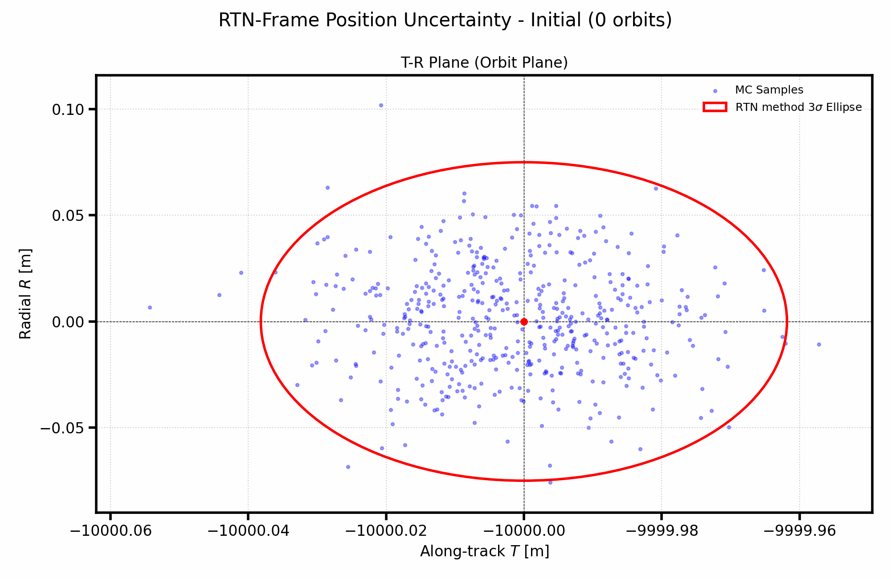

## Introduction

Standard linear covariance propagation updates $P(t) = \Phi(t, t_0) P_0 \Phi(t, t_0)^T$.

## Linear Covariance Propagation

## Coordinate Geometry

# Clohessy Wiltshire Equations

The CW (Clohessy Wiltshire) equations assumes the Chief satellite is in a circular orbit. These equations are defined in the the RIC (Radial, In-Track, Cross-Track) 
frame which is fixed to the Chief satellite. The radial unit vector is defined by @eq-Radial.

$$
\hat{R} = \frac{\mathbf{r_c}}{||\mathbf{r_c}||}
$$ {#eq-Radial}

Where \mathbf{r} is the position vector of the satellite in the ECI frame, and the subscript c denotes the chief satellite. The Cross-Track unit vector is then defined in @eq-Cross.

$$
  \hat{C} = \frac{\mathbf{r_c}\times\mathbf{v_c}}{||\mathbf{r_c}\times\mathbf{v_c}||}
$${#eq-Cross}

Where \mathbf{v} is the satellites velocity vector in the ECI frame. With the Radial and Cross-Track directions defined, the In-Track direction is defined as 

$$
  \hat{I} = \frac{\hat{C} \times \hat{R}}{||\hat{C} \times \hat{R}||}
$${#eq-IN}

# Relative Orbital Elements

## Simulation

# Setup

# Results

## Takeaways

Ullamco in tincidunt cupidatat fugiat fusce voluptate tempus, tempus risus enim nulla condimentum. Maecenas bibendum tempus commodo dapibus laoreet bibendum justo fermentum tortor felis condimentum, fusce reprehenderit ante magna risus. Vel a vel labore pellentesque euismod aliqua risus diam aliquet do, labore quam varius enim sit quis ac scelerisque euismod. Commodo fringilla eget eiusmod aliquet consectetur, amet sint felis fusce varius mollis reprehenderit et aliquet ullamco sapien. Sit fugiat eiusmod curabitur nisi ante ante in facilisis tellus velit eget morbi nullam, vestibulum lacus sem praesent. Ut nibh sit fringilla dolore commodo nostrud aenean varius porta nullam, pretium ullamcorper phasellus fusce.

Fringilla ad cursus viverra irure, convallis risus risus imperdiet viverra at consequat. Lacinia leo justo commodo commodo ut etiam eget quisque, in quis sit ut faucibus. Amet egestas risus pariatur culpa, sapien eget etiam occaecat deserunt aute voluptate enim molestie libero. Condimentum nulla eget in do viverra praesent, eget cursus consequat scelerisque leo voluptate esse pariatur aenean condimentum tortor. Tempor augue eget varius curabitur id venenatis tellus nullam rhoncus etiam semper, dapibus anim donec est risus. Quam varius consectetur ante diam eget, nullam quam risus mollis egestas rutrum esse. Fusce aute pretium ut justo magna morbi fringilla ullamco vel odio.

Nullam minim tellus esse orci aliquet justo in erat quis officia. Convallis adipiscing laoreet ut eros mollis morbi id porta ad, morbi deserunt elit posuere exercitation vel amet. Aute do varius risus imperdiet, aute tempus ultricies risus dapibus ac ipsum. Tincidunt qui reprehenderit auctor ultricies dapibus egestas faucibus nisi sem. Id vel ea incididunt est, rutrum massa tortor sed dolore nisi malesuada scelerisque ullamcorper. Justo praesent est augue irure turpis integer lorem ac pellentesque est consectetur laoreet, excepteur nulla ut minim in egestas magna. Metus euismod libero euismod fringilla consectetur, vestibulum risus tempor fermentum vestibulum morbi pretium etiam amet nec.

## References